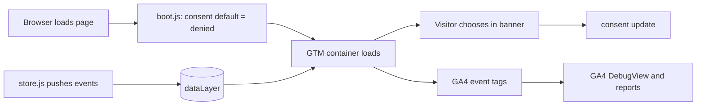

# Demo Store: Web Measurement Learning Project

A small demo online store I built to learn web measurement end to end: a clean **data layer**, **Google Tag Manager**, **GA4** e-commerce events, **Consent Mode v2**, and **hashed user data** for Enhanced Conversions concepts. It also includes a **bug lab** where I break the setup on purpose and practise diagnosing it, and a Python script that simulates sending an offline purchase through the **GA4 Measurement Protocol**.

> **Status: [In progress / Built]**  (edit this line to match reality)
> This is a personal learning project. It is not client work, and it makes no claims about business results. Real products, customers and payments do not exist here.

## What it demonstrates

| Area | Where |
|---|---|
| Consent Mode v2 defaults set to denied **before** GTM loads, then updated by a cookie banner | `src/boot.js`, `src/consent.js` |
| GA4 e-commerce events: `view_item_list`, `view_item`, `add_to_cart`, `begin_checkout`, `purchase` | `src/store.js` |
| Data layer hygiene (`ecommerce: null` reset before each push) | `src/store.js` |
| Email normalisation and SHA-256 hashing, attached only when `ad_user_data` is granted | `src/hash.js`, `scripts/hash_email.py` |
| On-page event log to compare with GTM Preview | `src/index.html`, `src/store.js` |
| Bug lab with four deliberate bugs and a findings log | `docs/bug-lab.md` |
| Offline purchase simulation through the GA4 Measurement Protocol | `scripts/measurement_protocol.py` |
| Automated tests (JavaScript and Python) and CI | `tests/`, `.github/workflows/ci.yml` |
| Design note for server-side tagging (not deployed) | `docs/server-side-tagging-design.md` |

## How the pieces fit



## Run it

Requires Python 3 (only to serve static files) and a browser. No build step.

```bash
python3 -m http.server 8080 --directory src
# open http://localhost:8080
```

`localhost` counts as a secure context, which the hashing code needs (`crypto.subtle`).

Out of the box the store runs in **dataLayer-only mode**: events appear in the on-page log, and GTM is not loaded because `GTM_ID` in `src/config.js` is a placeholder (a marker event `gtm.js.simulated` shows where the container would start). To connect it to your own containers, follow [`docs/gtm-setup.md`](docs/gtm-setup.md).

## Bug lab

Add a parameter to the URL to switch a bug on:

| URL | What breaks |
|---|---|
| `/?bug=late-consent` | GTM starts before the consent defaults are set |
| `/?bug=early-purchase` | `purchase` fires with empty `items`, then again with the full data |
| `/?bug=raw-email` | plain-text email in the data layer instead of a hash |
| `/?bug=no-normalise` | email hashed without trimming or lowercasing |

Details, diagnosis steps and fixes are in [`docs/bug-lab.md`](docs/bug-lab.md).

## Offline events with the Measurement Protocol

```bash
# Show the payload only
python3 scripts/measurement_protocol.py --dry-run

# Validate against Google's debug endpoint (records nothing)
export GA4_MEASUREMENT_ID=G-XXXXXXXXXX
export GA4_API_SECRET=your-secret
python3 scripts/measurement_protocol.py --debug
```

Never commit your API secret. `.gitignore` excludes `.env` files.

## Tests

```bash
node --test tests/*.test.js
python3 -m unittest discover -s tests -p 'test_*.py'
```

The JavaScript and Python hashing code are checked against the same known test vector.

## Project layout

```
src/        the demo store (HTML, CSS, JavaScript)
scripts/    Python helpers (hashing, Measurement Protocol)
tests/      JavaScript and Python tests
docs/       GTM setup guide, bug lab, QA checklist, server-side design note
```

## Limitations (honest list)

- GTM and GA4 are configured manually by following `docs/gtm-setup.md`; the repo does not include an exported container.
- Email formatting rules for Enhanced Conversions can change. Check Google's current documentation before relying on `src/hash.js`.
- Server-side tagging is a design note only.
- The Measurement Protocol script sends a simulated purchase and is not tied to a real ad click.

## What I learned

(Add your own notes after you finish the labs: what surprised you, what took longest to debug, what you would do differently.)

## License

MIT
